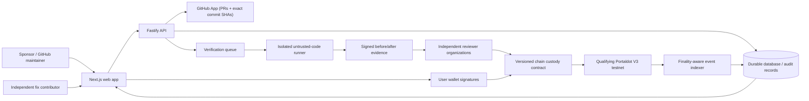

# CertiFiks — Hackathon technical architecture (planned and actual)

**Updated 2026-10-15** · **Issue #8** · **Status:** diagram of planned interactions, NOT evidence of existing integrations.

## What exists in the repository as of this document

| Component | Status as of October 15 | Precise evidence |
|---|---|---|
| Web | **Foundation builds only**, pre-launch page; no functional funding | [apps/web](../../apps/web) |
| API | **HTTP service starts**; health transport only | [apps/api](../../apps/api) |
| Database | **Not implemented**; no durable marketplace data | [#24](https://github.com/EcstaceeLOR/CertiFiks/issues/24) |
| GitHub App | **Not implemented**; no access/PR webhook used for verifications | [#20](https://github.com/EcstaceeLOR/CertiFiks/issues/20) |
| Sandboxed runner | **Explicitly disabled**; untrusted code must not execute on host | [workers/verifier](../../workers/verifier) |
| Canonical schema/hash | **Implemented and CI tested** across TS, Python and Solidity hash vectors | [protocol](../../protocol) |
| Smart contract | Historical **unsafe Solidity reference**; compiler/tests pass including vulnerability characterizations | [#6 review](../security/ESCROW_BASELINE_REVIEW.md) |
| Portaldot V3 deployment | **BLOCKED**; legacy mainnet read-only RPC probed, not eligible deployment proof | [network decision](../hackathon/network.md), [#18](https://github.com/EcstaceeLOR/CertiFiks/issues/18) |
| Indexer/wallet/withdrawal | **Not implemented**; no real transactions | [#16](https://github.com/EcstaceeLOR/CertiFiks/issues/16), [#27](https://github.com/EcstaceeLOR/CertiFiks/issues/27) |

**Non-negotiable:** The conceptual diagram is not a functioning app architecture until its indicated implementation issues have test evidence and running services. Do not present arrows as integrated APIs or transactions in a hackathon demo.

## Winning technical story — conditionally, after implementation
1. Sponsor creates a committed manifest for a real GitHub bug, including baseline SHA, trusted test, image digest, reward, time windows, and verifier policy.
2. Sponsor locks testnet reward under an actual Portaldot V3 contract. The source, address and transaction hash are public.
3. A developer submits a pinned GitHub revision; before/after tests run in isolated environment, with an independently reproducible bundle.
4. Distinct independently enrolled reviewer organizations attest the *exact same* report and commits, and an on-chain challenge period follows.
5. Authorized withdrawal closes the bounty. The web UX and evidence link reconcile to finalized chain state.

**Blocking risks:** real V3 testnet endpoint and deployment (#18); fair dispute and refund mechanics (#14–#17); GitHub App (#20); sandbox (#21); truthful user flows (#32–#36); full E2E (#40). Unresolved critical issues prohibit mainnet funds. The goal remains a complete startup product, not a contest-only mock.
