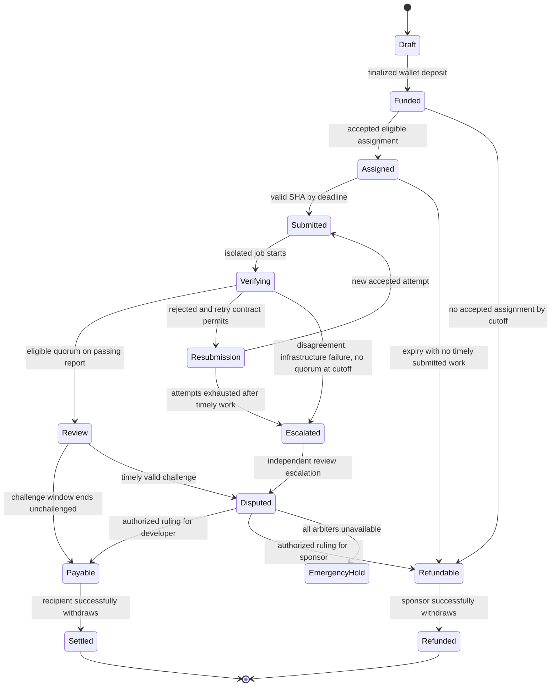

# Bounty and dispute state machine — v1 transition table

**Status:** SPECIFICATION. Real custody and autonomous timeout handling are NOT IMPLEMENTED. Issue #14 must choose and prove enforceable terminal dispute fallback before users can deposit value. See #3.

## 1. Operational state versus chain state
Server-only states may include DRAFT, QUEUED, RUNNING, INCONCLUSIVE and FAILED_JOB. Authoritative contract states must include FUNDED, ASSIGNED, SUBMITTED, REVIEW, DISPUTED, PAYABLE/REFUNDABLE and SETTLED/REFUNDED (actual ABI TBD). An API status, worker event or delayed indexer log is not authoritative for custody or beneficiary allocation.

### Mermaid process model

**EmergencyHold is NOT a completed/terminal outcome**: it explicitly identifies the currently unresolved all-adjudicators-missing case. Before mainnet funding can be enabled, #14/#15 must replace this state with a precommitted, enforceable and bounded path to a real terminal credit, rather than hiding or speculatively resolving it.

## 2. Transition and timeout decision table
| Current state | Trigger / deadline | Auth/guard | Result or exception | Custody effect |
|---|---|---|---|---|
| Draft | sponsor abandons draft | sponsor session | Abandoned; not a funded state | None |
| Draft | on-chain fund tx finalizes | correct chain/contract and immutable manifest hash, actual assets | Funded | Lock amount |
| Funded | assignment accepted before cutoff | sponsor selects, distinct developer consents, no prior assignee | Assigned | None |
| Funded | no assignment at cutoff | on-chain authoritative cutoff, no claim | Refundable | Allocate sponsor credit only |
| Assigned | accepted contributor submits head SHA on time | fixed repo/base/manifest, unique attempt | Submitted | Lock remains |
| Assigned | cutoff without timely submission | no submitted work, reassignment policy fixed | Reassign once or Refundable | Safe sponsor credit when applicable |
| Submitted/Verifying | candidate test fails or trust harness tampered | signed failure evidence and permitted retries | Resubmission if window, else Escalated or policy-specified rejection | No payout |
| Submitted/Verifying | positive independent quorum | exact bound report and eligible orgs | Review | No payout until challenge window |
| Submitted/Verifying | missing, conflicting, stale or inconclusive reports at verification timeout | timely submission stays protected | Escalated; bounded independent review | No unilateral sponsor refund |
| Review | challenge window passes without challenge | time fixed by contract; all proof checks met | Payable | Exactly one developer credit |
| Review | valid challenge before cutoff | authorized challenger, immutable reason and evidence | Disputed | Funds held pending ruling |
| Disputed | response window elapses | parties notified, fixed pre-funded response time | Primary ruling if available or fallback review | No immediate payout without policy |
| Disputed | primary arbiter does not answer before ruling cutoff | independent, predeclared fallback body | Escalated to fallback, new immutable bound deadline | Hold escrow |
| Disputed | fallback gives reasoned valid ruling | independent signers and evidence | Payable or Refundable | Allocate exactly one type of credit |
| Disputed | *all fallback* authorities disappear | NO SAFE V1 RULE YET | EmergencyHold — **release blocker**, cannot claim liveness | Escrow remains protected but unavailable |
| Payable | beneficiary withdraw succeeds | registered recipient wallet, nonreentrant and exact credit | Settled | Decrease credit once |
| Payable | transfer fails/reverts | external receiver failure | Remain Payable; enable safe authorized retry/recipient update by policy | No credit lost |
| Refundable | sponsor withdraws | refund eligibility and recipient | Refunded | Decrease credit once |
| Refundable | transfer fails | receiver revert/outage | Remain Refundable; safe retry | No credit lost |
| Settled/Refunded | any attempted mutation | terminal | Reject, not silently reopen | None |
| Any nonterminal | RPC/indexer outage/reorg | compare chain's canonical finality | Pending/Unknown off-chain, reconcile | No transfer inferred |
| Any nonterminal | unknown event, unsupported spec v2 or invalid version | fail closed | Reject and surface UNSUPPORTED_SPEC_VERSION | None |

## 3. Exact timing discipline
Deadlines are committed at funding. Use chain-verified timestamps/block heights, not database clocks, for deadlines affecting user money. Contract rules must explicitly choose inclusive/exclusive boundaries (e.g. submission accepted if block.timestamp <= submissionDeadline; challenge accepted if block.timestamp < challengeDeadline; withdrawal after >= challengeDeadline), test both sides with time-warp. API displays are derived and approximate pending finality.

The v1 manifest already specifies submissionUnix and duration windows for verification, challenge and arbitration, but exact state-trigger origins and fallback policy are deferred to #14/#15. Do not deploy a funding contract with unbounded escalation defaults.

## 4. Invariants that apply to every transition
1. Assets cover all unclaimed obligations and never create both full sponsor refund + full developer credit.
2. Only eligible assignee submits and only enrolled conflict-free signers satisfy quorum.
3. Every verification decision is bound to exact chain, contract, bounty, attempt, repository SHAs and immutable manifest.
4. Test infra failure cannot turn into a passing report or immediate refund that disadvantages timely submitted work.
5. Dispute liveness policy and emergency recovery must be explicit, enforceable and assessed by independent review.
6. Withdrawal failure cannot destroy credit or block withdrawal by other parties.
7. A reverted/unconfirmed transaction cannot appear settled in the app.
8. Terminal settlement is idempotent with a single on-chain beneficiary.

## 5. Actual verification requirements
Translate this specification into contract state-machine tests (#9–#17), runtime-appropriate VM tests (#18), queue/indexer recovery (#27/#28), real browser/wallet flows (#32–#36) and full E2E scenario (#40). The diagram is not an executable implementation.
