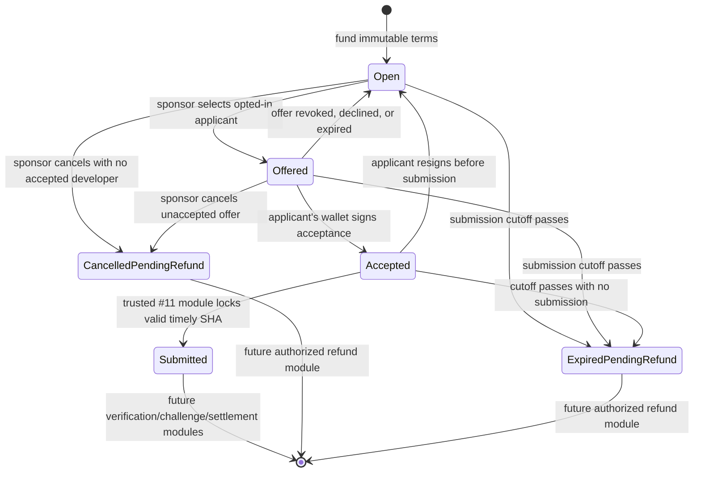

# CertiFiks — Developer application and assignment protocol v1

**Issue:** #10 · **Status:** locally implementable Solidity assignment layer; **not deployed or user-accessible** · **Date:** 2026-10-15

## 1. What exists

- [BountyAssignmentModuleV1.sol](../../contracts/src/BountyAssignmentModuleV1.sol) extends the internal-only [BountyFundingModuleV1.sol](../../contracts/src/BountyFundingModuleV1.sol) from the open Issue #9 branch.
- [BountyAssignmentModuleV1.t.sol](../../contracts/test/BountyAssignmentModuleV1.t.sol) contains a **test-only** funding and pinned-submission harness; neither harness exposes a safe deployable production escrow.
- Each application, sponsor selection, applicant response and resignation uses a **direct wallet-signed EVM transaction**. The contract authorizes `msg.sender`; it never trusts a client-supplied `applicantAddress` as proof of account control. There are **no permit/EIP-712 off-chain signatures** or stored signature blobs in this version.
- Immutable funding terms (manifest, baseline SHA, reward, deadlines and review/dispute policy hashes) are never changed during application, selection, resignation, rejection or expiration.
- There is **no mainnet deployment, approved V3 testnet contract, live API, GitHub App OAuth binding, tenancy database or frontend workflow**. Passing Foundry cases cannot close the original Issue #10's end-to-end criteria.

## 2. Actors and authorization

| Action | Eligible actor | Guard / behavior |
|---|---|---|
| Apply | Any non-sponsor wallet with no prior application to this bounty | Funded known bounty, exact chain ID, state Open, at least 1h remaining, max 32 pending |
| Withdraw pending or offered application | Exact wallet that applied | Immediately removes pending status, freeing capacity and cancelling its pending offer if present; cannot reapply with same wallet |
| Reject pending or offered application | Funding sponsor | Removes pending status, prevents reapplication with that wallet; does not change acceptance terms |
| Select contributor / make offer | Funding sponsor | Applicant status Applied, bounty Open and enough time to accept/work; at most one open offer |
| Accept offer | Exact selected wallet | Before offer expires; enough contractual work time remains; creates Accepted status |
| Revoke unaccepted offer | Funding sponsor | Only when Offered; returns applicant to Applied, preserving pending count |
| Expire offer | Anyone | Strictly after immutable offer expiry; returns applicant to Applied for optional future offer |
| Resign accepted assignment | Exact accepted contributor | Only **before** submission; releases active slot, leaving original terms immutable |
| Cancel unassigned bounty | Funding sponsor | Open or Offered only; flags CancelledPendingRefund, **does not move or allocate funds** |
| Mark no-submission expiry | Anyone | Only after contractual submission deadline and if no timely submission has been locked; flags ExpiredPendingRefund, **no transfer** |
| Lock a timely submitted candidate | Future trusted GitHub submission module (#11) | Internal-only; accepted contributor, correct chain, before deadline, one transition maximum |
| Change funded reward, manifest or deadline | **No one** | Not exposed. Must terminate/refund under future safe contract rules and create a **new bounty** |

### State transitions

**CRITICAL:** The last two arrows are **future work**, not actually executable settlement. A pending refund state does not create a withdrawable credit and **does not release any assets**. No user wallet can fund through production code. The contract deliberately cannot settle anything yet.

## 3. Consent, limits and fairness

1. **Two-party consent:** A sponsor cannot nominate a stranger who never applied; sponsor makes the offer, the selected developer separately submits a wallet-signed acceptance. Sponsor cannot later swap that accepted wallet unilaterally.
2. **Bounded exclusive work:** One accepted developer per bounty. Other applicants remain pending but cannot submit. Former developer loses the right after voluntary resignation. A timely locked submission stops reassignment, cancellation and no-submission expiry.
3. **Offer timing:** Fixed max offer lifetime is 24h, capped to leave at least 1h before the funded submission deadline. Expired offers need explicit state cleanup by anyone. A sponsor may revoke before acceptance, not after.
4. **No replay of opt-ins:** At most one application per wallet and bounty. Accepted/withdrawn/rejected wallets cannot reapply under a different state. Rejected/withdrawn statuses cannot become Accepted by an old offer.
5. **Spam safety (partial):** Maximum 32 **active pending** applications/bounty with a one-application-per-wallet rule. Sponsor can reject abusive applications to free slots. This is **not Sybil resistance**; an attacker can submit across wallets and impose gas/availability costs. #23/#24 must enforce off-chain account eligibility, rate limits, bans, and private repo policies; organization and verifier-role conflicts remain future requirements of #12.
6. **No unilateral sponsor refund after acceptance:** Sponsor can cancel before developer acceptance, not afterward. After accepted work has missed the contractual deadline without a submitted candidate, only a pending-refund state is recorded; actual amounts and entitlement require the verified implementation of #15/#16.
7. **Immutable terms:** No assignment mutation changes stored `BountyTerms`. The specific application/offer policy is fixed in the v1 Solidity code. Any different reward/manifest/expiration demands a freshly funded bounty; no silent sponsor edits.
8. **Chain context:** Every wallet-state mutation checks `block.chainid` against the immutable expected chain ID; real V3 genesis and wallet validation require #18 before network acceptance.

## 4. Tests and evidence

Foundry suite covers honest apply→offer→accept→submit authorization, double-selection denial, sponsor self-application rejection, spoofed accept, duplicate application and acceptance, sponsor rejection/withdrawal, capacity overflow and recovery, offer revocation/expiry/replay, minimum work window, voluntary pre-submission resignation and reassignment, cancel-before-accept and no-cancel-after-accept, missed deadline and no-submission expiry, protection of timely submitted work, wrong network, separation of two bounties, conservation of locked assets, and fuzzing unselected wallet rejection.

Run (from repo root): `cd contracts && forge clean && forge build && forge test -vv`. The test-only `simulatePinnedSubmission` is a **test hook**, not authentic GitHub verification. #11 must bind and authenticate exact GitHub PR, repository ID, baseline/head SHA and image digest.

## 5. What is still needed for the full production feature

- **#9 / #18:** safe funded escrow deployed on organizer-approved Portaldot V3, authentic contract receipt/explorer address, correct runtime and chain identity.
- **#23 / #24:** GitHub App + wallet linking, persistent real applications with tenant permissions and server-enforced abuse limits, verified identities/repositories.
- **#11:** pinned PR commit identity; real on-chain/authenticated accepted-developer submission so the temporary submission hook cannot become a production bypass.
- **#12 / #13:** disallow sponsor/applicant conflicts with verifier or arbitrator controllers, not merely wallet address distinctions.
- **#14–#17:** fair terminal dispute/refund/withdrawal and tested value-conservation, no stuck funds or unilateral cancellation.
- **#26 / #32 / #33 / #40:** authenticated API and actual responsive sponsor/applicant/offer/accept UX with two distinct wallets and E2E receipts.

**Release verdict:** useful tested internal assignment logic; **NOT a fully working user journey**, **not merged as a complete funding feature**, and **not safe to receive real tokens**. It is intentionally delivered as a **stacked draft PR** based on unmerged Issue #9 until all real acceptance gates can pass.
