# CertiFiks — Bounded arbitration, appeal and custody separation (Issue #14)

**Status:** local contract code and test-harness decisions only. **No deployed dispute service, real arbitrators, signed human evidence storage, payouts, or refund transfers.** This document describes a proposed, centrally vetted trust model, not a trustless court or a completed startup feature.

## Contract boundaries

`contracts/src/BoundedArbitrationModuleV1.sol` is **abstract** and extends the unmerged #9 funding, #10 assignment, #11 exact GitHub submission, #12 reviewer registry and #13 EIP-712 verdict modules. The chain stores wallet-signed arbitrator decisions and immutable reason/evidence hashes, but it cannot evaluate whether an off-chain test actually proved the defect was fixed. **Only #15–#17 may implement audited terminal credits/transfers; #14 does not move or claim a single token.**

**Independence and consent:** the sponsor commits the immutable primary arbitrator address at funding. The immutable `disputePolicyDigest` also precommits one distinct **fallback arbitrator** through
`SHA256(abi.encode("CertiFiks:arbitration-policy:v1", primaryWallet, fallbackWallet))`.
After funding, sponsor registers exactly that policy before assignment, central registry governance checks and approves it, and *each arbitrator's wallet signs an individual opt-in transaction*. An abstract assignment extension denies sponsor job offers until the sponsor's #12 reviewer roster is configured, **at least the committed independent quorum is currently active**, **both** arbiters are approved and have consented, and the selected applicant is not a controller or signer (including historical keys) of any organization on that bounty's roster, or either arbitrator. The roster is retained in an indexed array rather than only a membership lookup so pre-assignment availability is actually checked. The same quorum, organizational conflict and independent-arbiter checks run **again at the developer's actual wallet-signed acceptance**, not just at the sponsor's offer, preventing a revoked reviewer, compromised arbiter or newly conflicted developer from accepting during an outstanding offer. An active organization can still go offline *after* acceptance; this is a guard, not an SLA guarantee. Ineligible arbitrator wallets: sponsor, accepted developer, registry governance wallet, any signing/controller wallet ever linked to a reviewer organization, and a wallet that duplicates the other arbiter. When one enters a conflicting reviewer organization later, the contract blocks that arbiter from ruling. Governance may irreversibly disqualify a compromised wallet with a nonzero reason digest; never replace precommitted wallet addresses or silently reset review time.

**Centralization and collusion remain real risks:** governance checks are discretionary; different wallets and controller signatures do not prove different beneficial ownership or honest dispute adjudication. Real independent organization admission, documented terms and multisig key custody need #23/#24/#41 and accountable operational policies. A permanently revoked arbiter can no longer rule, but the original timeouts remain usable by *anyone*.

## Who may challenge and what a challenge means

- **Approved review:** only the original sponsor or accepted developer can file a challenge during the immutable positive review's `challengeUntil` window. A challenge includes a **nonzero reason digest AND nonzero evidence digest**. A sponsor cannot reopen/extend this window, insert different evidence, cancel a submitted fix, or induce an immediate sponsor refund.
- **Rejected, inconclusive, runner failure:** either interested party can open an arbitration case immediately; the dispute starts from the original attempt's immutable `submittedAt + verificationSeconds` deadline. Before that cutoff strangers cannot file a new escalation. At/after the deadline, a public caller can open it so both interested parties cannot indefinitely stall progress.
- **Missing quorum:** once the verifier deadline is reached, anybody may open escalation even if the #13 decision still reads `Pending`. The later #15 accounting module must give precedence to the arbitration case's terminal status over an earlier unsigned/pending report; no report may be accepted past the job's signed expiry.
- **No challenge:** once a positive independently signed quorum's immutable challenge window has expired, anyone can finalize an unchallenged entitlement as `DeveloperReward`. No wallet receives any tokens at this stage; it only records an entitlement for a *future, audited* settlement module.

An on-chain digest is an evidence reference, **not proof evidence exists or is authentic**. #22/#24/#26 must archive signed versioned evidence, provide the other party access and a response period, preserve proof of notice, and bind the actual off-chain report hash to the on-chain value. The current module cannot determine whether a submitted hash describes false or irrelevant evidence.

## State machine

```mermaid
stateDiagram-v2
    [*] --> PrimaryReview: timely challenge or escalated review
    PrimaryReview --> PrimaryAppealWindow: primary wallet rules before immutable cutoff
    PrimaryReview --> FallbackReview: primary silent / disqualified at deadline
    PrimaryAppealWindow --> Resolved: losing party does not appeal before deadline
    PrimaryAppealWindow --> AppealReview: losing party appeals once with new evidence
    FallbackReview --> Resolved: fallback wallet rules OR all-arbiter timeout
    AppealReview --> Resolved: fallback rules OR fallback silent; primary ruling stands
    PrimaryReview --> Superseded: authorized new attempt makes old case stale
    PrimaryAppealWindow --> Superseded: authorized new attempt
    FallbackReview --> Superseded: authorized new attempt
    AppealReview --> Superseded: authorized new attempt
```

`Resolved` means *entitlement decision only*, with `Award.DeveloperReward` or `Award.SponsorRefund`. `None` and `Superseded` cannot be credited. If a new permitted fix attempt supersedes an open dispute, the old case can be marked `Superseded`; #15/#16 must always check the current on-chain attempt ID before any credit. This prevents replaying an old case's award onto a new committed fix.

## Exact bounded deadlines (all computed from immutable funded durations)

For a positive review with quorum, let `anchor = review.challengeUntil`. For a rejected/inconclusive/timed-out/no-quorum review, let `anchor = attempt.submittedAt + verificationSeconds`.

- **Primary arbitration deadline:** `anchor + arbitrationSeconds`.
- **Fallback finalization deadline:** `primaryDeadline + challengeSeconds + arbitrationSeconds`.
- **If the primary rules before its deadline:** the losing party may appeal until `min(primaryRulingAt + challengeSeconds, primaryDeadline + challengeSeconds)`.
- **If the losing party appeals:** only the precommitted fallback wallet may issue its ruling before the fallback deadline. An unresponsive fallback **cannot indefinitely block** the original primary ruling; `advanceDispute` eventually makes that primary ruling the final entitlement.
- **If the primary never rules:** `advanceDispute` starts a bounded fallback stage at the primary cutoff. The precommitted fallback may rule until fallback deadline. If both ignore the case, anyone calls `advanceDispute` and the deterministic default applies; there are no indefinite contract-owned gates or sponsor-extendable deadlines.
- **If unchallenged after positive quorum:** any actor may record DeveloperReward entitlement after `challengeUntil`; only once.
- **Clock type:** `block.timestamp`; all contract stages are limited by `uint64` and fail on overflow. This relies on the chain's honest timestamp rules and requires #18 Portaldot V3 verification.

### Deterministic no-arbitrator default — currently provisional / no-go for user funds

When **both** committed arbitrators are silent or disqualified, local v1 rules use the immutable reviewer decision:
- Independently signed positive quorum already achieved and challenged: **DeveloperReward** — the sponsor cannot block an established independent approval just by refusing to arbitrate.
- No positive quorum (inconclusive/rejected/timed-out): **SponsorRefund** — unverifiable fixes cannot automatically earn a reward.

**This is an explicit economic assumption, not a universally fair resolution.** A real contributor may do valid work and lose their reward if reviewers and arbiters are unavailable, while a dishonest reviewer quorum could favor a bad fix. Before any public deposits, #15/#41 must stress-test this default, require genuinely independent named counterparties, consider a sponsor-funded neutral runner-outage remedy or bounded no-fault compensation, and publish accepted economic terms. **No mainnet/user-funds launch** on an unreviewed default.

## A single appeal, with transparent process

A primary finding is *not final immediately*. Only the party who lost that primary ruling may appeal **once**, within the fixed appeal window, with a distinct nonzero reason and evidence hash. The beneficiary of the ruling may not appeal a result they already won. The fallback decides once; it cannot be appealed again through this module. If the fallback remains silent, the signed primary decision stands after the immutable deadline. No appeal can be made after resolution, no case may be opened twice for one attempt, and no conflicting second ruling can overwrite historical artifacts.

The current implementation takes **no monetary challenge bond or filing fee**, pays **no arbitrator compensation**, provides **no actual notice/delivery of reports**, and enforces **no human response rights** beyond fixed windows. These are release-blocking operational/product economics for #14/#15/#24/#26, not features to fake using UI or test fixtures. The deployed product must disclose estimated service fees, arbitral terms, decision bias risks and which party pays costs; failure of operator service must have an explicit user remedy.

## Threat matrix and Foundry evidence

| Attack or failure | Intended contract outcome |
|---|---|
| Sponsor requests arbitrary new arbitrator or relabels dispute policy | Hash mismatch and one-time registration reject |
| Governance appoints unconsented arbiters or alters reviewer list | Developer offer blocked until explicit opt-in and committed quorum |
| Sponsor tries offering job while committed quorum is inactive/revoked | Assignment refused; no engagement dependent on unavailable reviewers |
| A reviewer is revoked or arbiter compromised between offer and developer acceptance | Developer acceptance also checks current quorum and arbitrators; no stale offer is treated as safe consent |
| Offered developer becomes a verifier signer in the committed roster before accepting | Reject conflicted acceptance; existing offer remains reversible |
| Reviewer org signer/controller or historically rotated signing key applies as developer | Assignment refused for a bounty whose roster includes that org |
| Sponsor attempts to assign original or fallback arbitrator as developer | Assignment refused before acceptance |
| Arbitrator shares sponsor, developer, org signer/controller or registry governance wallet | Conflict rejection on setup/assignment/ruling |
| Sponsor's challenge has no reason/evidence or tries to extend time | Reject; immutable reason & evidence persist |
| Stranger challenges approval before cutoff | Reject; only sponsor/developer |
| Either side tries to set a new appeal deadline | Reject; anchored to immutable funding windows |
| Primary is silent or key compromised | Permissionless fallback starts at deadline; governance may permanently disqualify key |
| Fallback is silent, revoked or both arbiters absent | Permissionless terminal decision after fixed fallback deadline |
| Losing party appeals with new evidence before cutoff | One appeal allowed; fallback controls terminal result |
| Winning party tries to appeal / caller repeats an appeal | Reject |
| Conflicted, fake or late arbiter signs ruling | Reject |
| Review is inconclusive or worker unavailable | Never auto-approve; bounded escalation defaults are explicit |
| Old bounty attempt is replaced after newly authorized revision | Old pending case can be marked Superseded; cannot rule for former attempt |
| Sponsor claims entitlement is already paid | False: contract has **no** transfer/credit functions; reserves unchanged |
| A fraudulent evidence hash passes as true content | **Not prevented by on-chain hash alone** — requires #22/#25 independent archival, audit and human response |

## Release gates

- [x] Unit / fuzz tests for wallet roles, challenge timing, reason-hash binding, one-time appeals, late/repeated resolutions, compromised keys, auditor quorum and no ETH leakage.
- [x] Bounded timed state transitions with public caller liveness and immutable case record.
- [ ] Genuine arbitrator organizations and published independence/eligibility/fee policy; neutral fallback accepted by all parties.
- [ ] Case and evidence storage/API, notice, party response, signature/document provenance and finalized event indexer (#22/#23/#24/#27).
- [ ] Explicit appeal procedure for off-chain process failure and fair no-fault compensation after reviewer outage.
- [ ] Safe #15 entitlement accounting and #16 non-reentrant pull withdrawals with real V3 deployment receipts (#18).
- [ ] Real dispute reaching **terminal payout/refund** with audited value conservation, not just a simulated local award (#40/#41).

**Decision:** code may be reviewed in a stacked **draft PR**. Keep **Issue #14 open** until real service and value-moving acceptance conditions hold. No test harness is deployable production custody.
